<p align="center"></p>

Prospecção por DM no Instagram para **qualquer nicho**, operada por um agente de código (**Codex** ou **Claude Code**). Os scripts acham os perfis, leem as bios e mandam as mensagens num Chrome logado, pelo Chrome DevTools Protocol. O agente faz o que pede julgamento: escolher quem entra, escrever uma DM com um detalhe real de cada perfil e responder quem respondeu.

Não usa API do Instagram, não guarda senha e não tem dependência: é Node puro.

<p align="center"></p>

## Por que assim

- **Uma pergunta, não um pitch.** A primeira DM cita algo real do perfil e termina numa pergunta fácil de responder. O pitch vem depois que a pessoa responde.
- **O agente escreve, o script envia.** Texto personalizado precisa de julgamento, e envio precisa de disciplina. Cada parte fica com quem faz melhor.
- **Ritmo de conta real.** Teto diário, intervalo sorteado, pausa de almoço, horário comercial e parada imediata no primeiro sinal de bloqueio.
- **Confere antes de mandar.** Só envia se a conversa aberta for do perfil certo, se o texto na caixa bater com a DM e se ainda não houver mensagem nossa no fio.

## Começar

Precisa de **Node 22+** e **Google Chrome**.

```bash
git clone <este repositório> && cd prospec-instagram
cp config.exemplo.json config.json      # sua oferta, nichos, cidades, limites e horário
npm run chrome                          # abre um Chrome separado; faça login no Instagram nele e deixe aberto
```

O Chrome de prospecção usa um perfil próprio (`~/.chrome-prospec-ig`) e a porta de depuração fica só em `127.0.0.1`. A sessão do Instagram fica no Chrome: nenhuma senha passa pelo repositório.

## O dia a dia

```bash
npm run busca                              # nichos × cidades do config → dados/busca.json
node scripts/busca.js "pilates campinas"   # ou termos avulsos
npm run perfis                             # lê bio e cabeçalho → dados/perfis.json
npm run lote                               # o Codex escreve dados/lote.json (AGENTE=claude para o Claude Code)
npm run dm -- 1 10                         # envia do 1 ao 10, respeitando teto e horário
npm run inbox                              # ">>" = a pessoa respondeu
node scripts/fio.js <handle>               # a conversa inteira
node scripts/responde.js <handle> resposta.txt "trecho da última msg deles"
```

Ou abra o agente na pasta e peça em português: *"lê o AGENTS.md, busca clínicas de estética em Campinas e monta o lote"*, *"vê quem respondeu e responde seguindo o PLAYBOOK"*.

## Com o agente

| Arquivo | Para quê |
|---|---|
| `AGENTS.md` | Regras e fluxo. O Codex lê sozinho; o `CLAUDE.md` importa o mesmo arquivo para o Claude Code. |
| `PLAYBOOK.md` | Abordagem: quem procurar por nicho, a primeira DM e as respostas para cada caso. Edite para a sua oferta. |
| `config.json` | Remetente, oferta, nichos, cidades, pergunta final, limites e horário. |
| `scripts/escreve-lote.sh` | Chama `codex exec` (ou `claude -p`) para transformar `dados/perfis.json` em `dados/lote.json`. Não envia nada. |

Formato do lote (`exemplos/lote.exemplo.json`):

```json
[{ "h": "handle", "quem": "Nome do negócio", "onde": "Cidade", "por": "o detalhe citado", "dm": "texto da DM" }]
```

## Segurança da conta

| Regra | Onde está |
|---|---|
| Teto de DMs por dia (padrão 10, para conta nova) | `limites.dms_por_dia`, travado no `dm.js` |
| Intervalo sorteado entre envios (padrão 8 a 15 min) | `limites.intervalo_min` |
| Só em horário comercial, com pausa | `horario` |
| Sinal de bloqueio: para tudo (sai com código 2) | `BLOQ` em `scripts/config.js` |
| Quem pediu para sair nunca mais recebe | `dados/optout.txt` |
| Não segue nem curte no mesmo dia | `AGENTS.md` |

Automação de DM vai contra os termos de uso do Instagram. Use numa conta que você pode arriscar, em volume baixo e com mensagens de verdade, uma a uma.

## Estrutura

```
scripts/
  config.js        config, caminhos, horário e sinais de bloqueio
  cdp.js           cliente CDP mínimo + envio que clica no botão "Enviar"
  busca.js         acha perfis pela caixa de pesquisa
  perfis.js        lê bio e cabeçalho
  dm.js            envia o lote com teto, intervalo e horário
  inbox.js         lista a caixa de direct
  fio.js           lê uma conversa
  responde.js      responde numa conversa existente
  abrir-chrome.sh  abre o Chrome de prospecção
  escreve-lote.sh  pede o lote ao Codex ou ao Claude Code
dados/             fica fora do git: buscas, perfis, lote, log e opt-out
```
